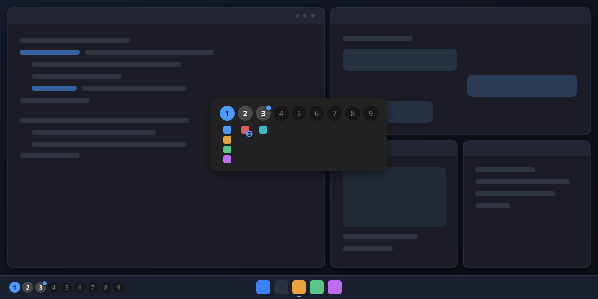

<div align="center">

# HawkTile

**Keyboard-driven tiling for Windows, as a single [Windhawk](https://windhawk.net) mod.**

Windows snap into a tidy layout on their own, every monitor gets its own
workspaces, and your hands stay on the keyboard.



[](LICENSE)


[](CLEANROOM.md)

</div>

---

## Why you might like it

- **It just tiles.** Open a window and it slots into the layout. Close one and
  the rest fill the gap. Five layouts: *dwindle*, *master*, *columns*, *rows*
  and *monocle*.
- **Workspaces per monitor.** Up to nine on each screen, switched
  independently. A small indicator on every taskbar shows where you are; click
  a number to jump there. Hold **Alt** to see every workspace with its apps,
  and drag an app onto another workspace to move it there.
- **It notices things for you.** When an app on another workspace flashes for
  attention, its workspace gets a little dot. Click a Windows notification and
  HawkTile takes you to the right workspace and opens the app.
- **Feels familiar.** Default keys follow [Omarchy](https://learn.omacom.io/2/the-omarchy-manual/53/hotkeys)'s
  Hyprland setup, with **Alt** instead of Super. Commands use Hyprland's names.
- **Mouse still works.** Drag a window onto another to swap them, drag its
  border to resize, and the neighbours follow.
- **Looks like Windows.** Indicators follow your light/dark mode, accent color
  and high-contrast settings, and the focused window gets a colored border on
  Windows 11.
- **Stays out of the way.** It runs in its own process and never injects into
  Explorer or your apps. Turn it off and every window comes back.

## Get started

1. Install [Windhawk](https://windhawk.net) (1.7 or newer).
2. Open [`dist/hawktile.wh.cpp`](dist/hawktile.wh.cpp) and copy all of it.
3. In Windhawk, choose **Create a new mod**, replace the example code with what
   you copied, and click **Compile Mod**.
4. Click **Exit editing mode**, then make sure the mod is **enabled**.
5. Your windows tile. Press **Alt + Shift + P** any time to pause.

To update, open the mod in Windhawk, choose **Edit**, paste the new version
and compile again. Your settings are kept.

## Keys

| Keys | What happens |
|---|---|
| **Alt + ← ↑ → ↓** | Focus the window in that direction (crosses monitors) |
| **Alt + Shift + ← ↑ → ↓** | Swap with the window in that direction |
| **Hold left Alt** | Workspace overview: drag an app's icon onto another workspace to move its windows there, click a number to switch, click an icon to go to the app |
| **Alt + 1 … 9** | Switch workspace |
| **Alt + Shift + 1 … 9** | Move the window to that workspace and go with it |
| **Alt + W** | Close the window |
| **Alt + F** | Fullscreen (maximize) and back |
| **Alt + T** | Float / tile the window |
| **Alt + J** | Flip the split direction (dwindle) |
| **Alt + L** | Next layout |
| **Alt + = / −** | Grow the window to the left / right |
| **Alt + Shift + = / −** | Grow the window down / up |
| **Alt + M** | Monocle: one window at a time |
| **Alt + Shift + Enter** | Swap with the master window |
| **Alt + Shift + R** | Re-scan windows and monitors |
| **Alt + Shift + P** | Pause / resume tiling |

> **Heads-up:** with these defaults, Alt + ← / → no longer means *back* and
> *forward* in browsers and File Explorer, and a few editors use
> Alt + Shift + arrows too. Everything can be rebound in the mod's settings.

## Make it yours

Everything lives in the mod's **Settings** tab in Windhawk, in a few
collapsible sections:

| Section | Settings (defaults) |
|---|---|
| **Layout and gaps** | default layout (dwindle) · workspaces per monitor (9) · outer and inner gap (8 px) · master size (55 %) · resize step (5 %) |
| **Workspace indicators** | badges on the taskbar (on) and their offset (12 px) · workspace popup (on) and its duration (2000 ms) · hold Alt for the overview (on) and the hold delay (400 ms) · notification dots (on) |
| **Window handling** | tile maximized windows · float non-resizable and always-on-top windows · follow activated windows (all on) |
| **Focus border** | on/off (on) · color (`4C9AFF`, Windows 11 only) |
| **Rules** | float rules (dialogs, file-copy progress, Picture-in-Picture) · ignore rules (none). Write them as `process:app.exe`, `class:#32770` or `title:text` |
| **Key bindings** | a list of *keys* + *command* pairs, see the commands below |
| **Advanced** | debug log file (off) |

> The **Advanced** tab next to Settings has a box full of JSON. That's
> Windhawk's export/import feature for sharing settings; you never need it.

### Commands

Bind any key to any of these. `<dir>` is `left`, `right`, `up`, `down` (or
`l`, `r`, `u`, `d`).

| Command | |
|---|---|
| `movefocus <dir>` · `swapwindow <dir>` · `resizeactive <dir>` | Move around, swap, resize |
| `workspace <1-9 \| next \| prev>` | Switch workspace |
| `movetoworkspace <n>` · `movetoworkspacesilent <n>` | Move the window and follow it, or move it and stay |
| `focusmonitor next` · `movetomonitor next` | Monitors |
| `nextlayout` · `layout <name>` | Layouts |
| `togglefloating` · `togglemonocle` · `fullscreen` · `togglesplit` | Window modes |
| `swapwithmaster` · `growmaster` · `shrinkmaster` | Master layout helpers |
| `rescan` · `toggletiling` · `closewindow` | Everything else |

Keys are written like `alt+shift+h`, `ctrl+alt+f1` or `win+alt+left`. Most
`win+` combinations belong to Explorer and won't register; the mod log tells
you which ones failed.

## Good to know

- **Where did my window go?** It's probably on another workspace: check the
  taskbar badges. Turning the mod off always brings every window back, and so
  does the next start if HawkTile was killed.
- **A window won't tile.** Dialogs, always-on-top and non-resizable windows
  float on purpose. Windows running as administrator can't be moved unless
  Windhawk itself runs elevated.
- **A window is bigger than its tile.** Some apps have a minimum size; give
  them a bigger slot with the resize keys, or let them float.
- **Windows' own virtual desktops** aren't integrated yet. Switching them makes
  HawkTile pick the windows up again.

## How it works

HawkTile runs as a Windhawk *tool mod*: Windhawk starts it in its own
background process, where it watches window events, keeps a model of monitors,
workspaces and windows, and moves windows with plain Win32 calls. Workspaces
work by hiding windows, and the list of hidden windows is saved so nothing gets
lost. The layout engine is a small set of pure functions covered by more than
a thousand unit-test checks.

The long version is in [docs/DESIGN.md](docs/DESIGN.md), and
[docs/research-windhawk-mods.md](docs/research-windhawk-mods.md) collects what
we learned from other Windhawk mods.

## Building from source

The source lives in [`src/`](src) as small fragments that
[`build.ps1`](build.ps1) joins into the single file Windhawk needs. You only
need Windhawk installed: the build uses its bundled compiler.

```powershell
powershell -File build.ps1               # build dist/hawktile.wh.cpp and compile-check it
powershell -File build.ps1 -Test         # run the layout unit tests
powershell -File build.ps1 -Standalone   # dev exe; tiles your real windows, Enter quits
```

## Clean room

HawkTile was written independently, without looking at the code of other
tiling window managers. How it was built, what was and wasn't used, an audit of
every step and the honest limits of that claim are in
[CLEANROOM.md](CLEANROOM.md), with the full record in
[docs/provenance](docs/provenance/README.md). If you contribute, please keep it
that way: don't paste code from other window managers.

## Credits

- [Windhawk](https://windhawk.net) by Ramen Software, which makes mods like this
  possible. The tool-mod launcher comes from its documentation (see
  [THIRD_PARTY_NOTICES.md](THIRD_PARTY_NOTICES.md)).
- [Omarchy](https://omarchy.org) for the keymap HawkTile's defaults follow, and
  [Hyprland](https://hyprland.org) for the command vocabulary.
- Written by Claude (Anthropic) models under the direction of Jonatan
  Jacobsson: Opus planned and reviewed, Haiku wrote the code.

## License

[MIT](LICENSE)
